# Free Models redesign handoff

Updated: 2026-09-11

This document records the model detail redesign, the original feedback, and the implementation status. The three pending implementation tasks from the original handoff are complete. Further visual changes can follow user feedback.

## Current state

### Homepage orbit hero — latest direction

The user rejected the task showcase card and requested a large centered orbit around the headline, description, and CTA. The latest implementation replaces that card with tilted orbit paths, a subtle lime glow, task glyphs, and publisher/API provider logos. The model list layout remains unchanged.

Latest user requests applied:

- Include publisher and provider icons alongside code, image, audio, video, transcription, and embedding glyphs.
- Make the orbit more expressive with tilted rings, varied logo sizes, and different speeds.
- Copy SVG geometry from the installed library and animate the glyphs themselves. Lucide v1.37.0 geometry is preserved in `orbit-icon.tsx`, with its license in `lucide-icons.LICENSE`.
- Remove task labels, icon borders, and shadows. Animated task glyphs now use small neutral circular backgrounds (48px desktop, 44px mobile); publisher/provider artwork stays bare. Gentler internal movement and more separation between orbit paths address the feedback that the hero icons looked out of place.
- Animate the copied SVG details: code braces open/close, audio bars bounce, image/microphone shapes pulse, the video glyph signals, and database strokes flow.
- Give more brands a chance to appear: four stable brand positions cycle through every publisher/provider in the supplied data that has a known logo URL. One position changes every 2.8 seconds.
- No motion button. Reduced-motion preferences disable orbit movement, glyph motion, and logo swapping. Keyboard focus within the hero and hidden tabs pause motion and swapping.
- Show actual model names in the orbit without ranking labels. The user rejected the stationary pills, then asked for horizontal `<icon> <model name>` pairs. Up to four clickable model names now revolve on the outer desktop ring, interleaved with four rotating publisher/provider logos. On mobile, two model names drift along the upper/lower arcs to remain visible. Latest follow-up: the icon and name now share one 40px neutral pill, with both the logo and text line measuring 20px tall. No icon borders. Desktop and 320px mobile measurements confirm matching heights and no page overflow.
- Selection still interleaves the three highest intelligence scores and three highest coding scores, deduplicates models, and excludes missing scores. Names cycle every 8.4 seconds. Hovering a model link pauses motion and changes; keyboard focus and reduced motion remain supported.

Code: [hero-orbit.tsx](apps/web/src/components/hero/hero-orbit.tsx), [orbit-icon.tsx](apps/web/src/components/hero/orbit-icon.tsx), [hero-typographic-broadsheet.tsx](apps/web/src/components/hero/hero-typographic-broadsheet.tsx), and [globals.css](apps/web/src/app/globals.css). The old `hero-showcase.tsx` was removed.

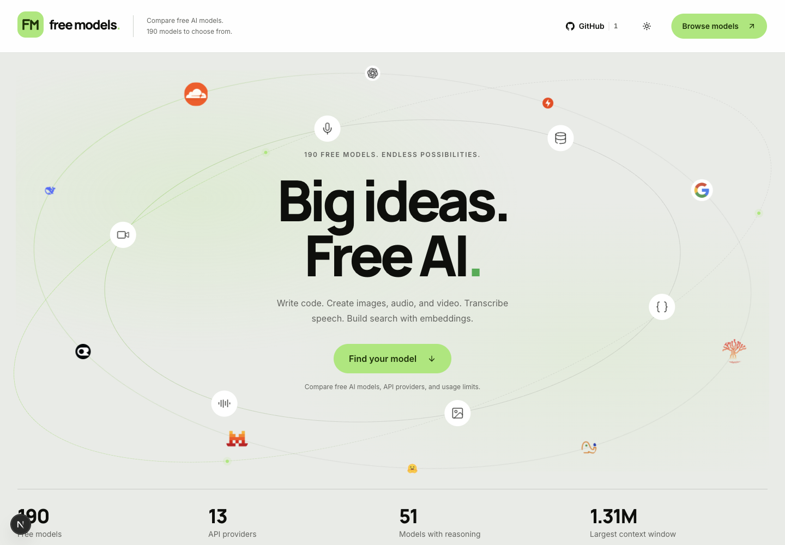

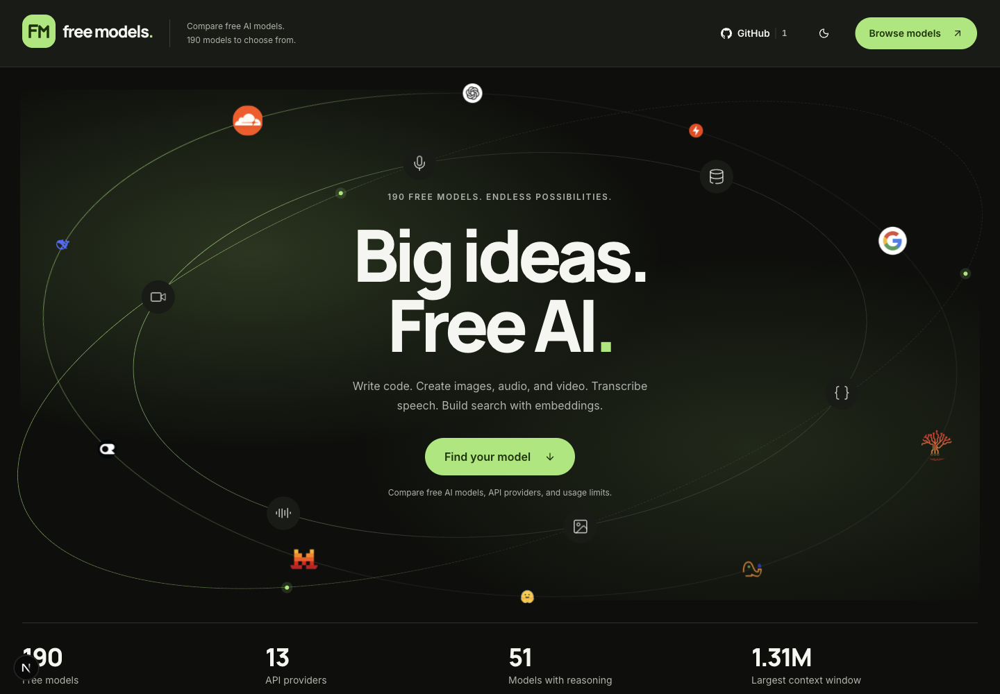

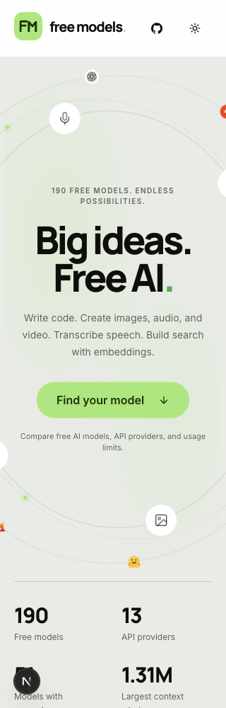

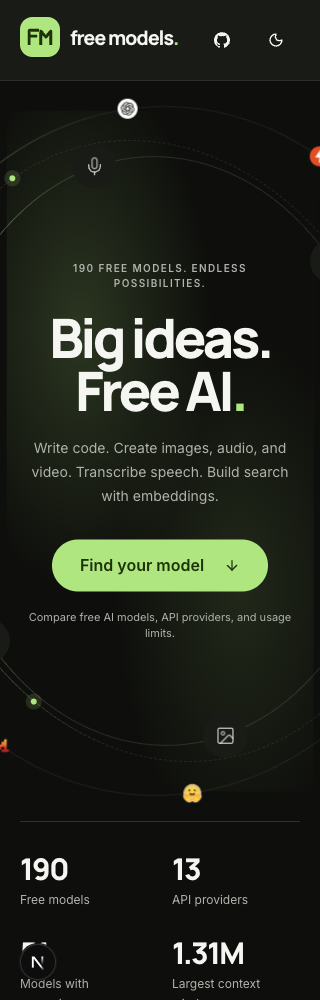

Earlier reference images remain in `docs/handoff/assets/` for historical context. They no longer represent the homepage hero.

Latest verification: refreshed all four hero screenshots above, checked 320px and 1440px in light and dark themes with no horizontal overflow, and confirmed reduced motion disables both orbit and internal glyph animations. The hero refinement is implemented and ready for user review.

Model-name addition: the 194-page static build, TypeScript, and targeted Biome checks pass. The stationary-pill references below were rejected; see the horizontal orbit references for the current implementation:

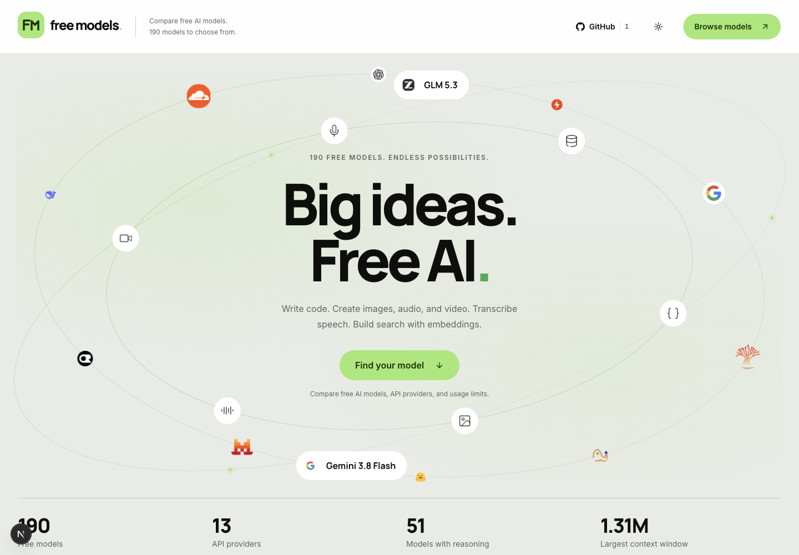

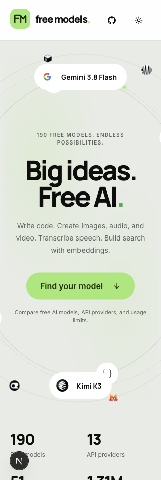

Latest revision: horizontal icon/name pairs, checked visually at 1440px and 320px with no page overflow. Targeted Biome checks pass. The orbit implementation also passed TypeScript and the 194-page static build before this final layout adjustment.

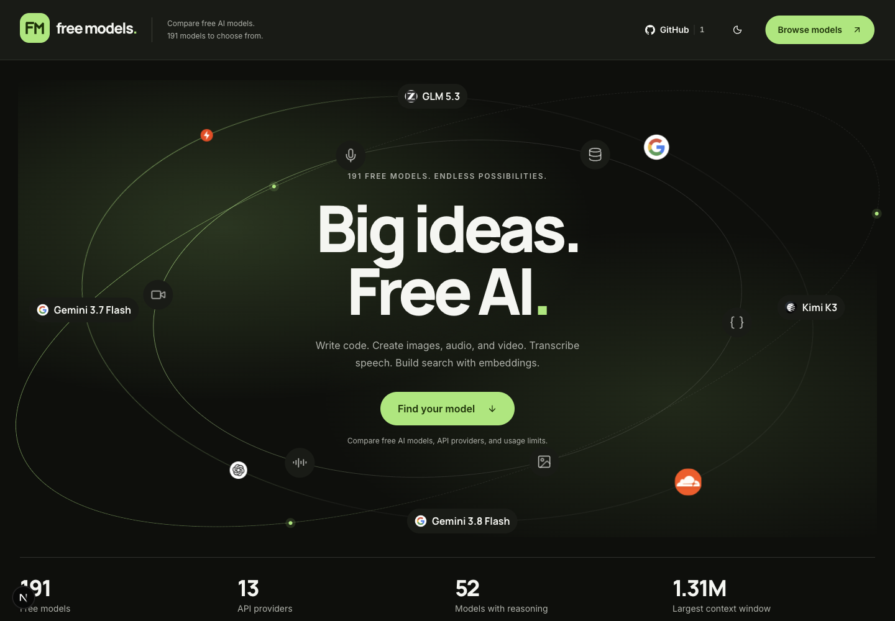

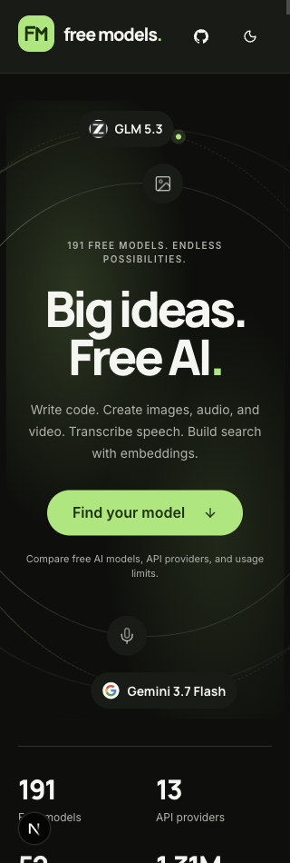

### Combined provider button

The model detail sidebar now combines the provider link and logos in one button. It shows up to three logos plus a `+N` overflow count, keeping the button compact when a model has many providers. The accessible name includes the total provider count and the link targets the provider section.

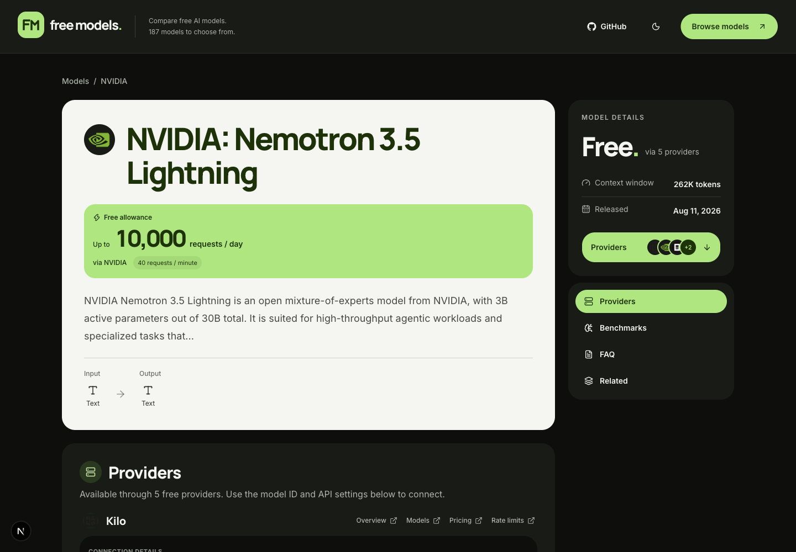

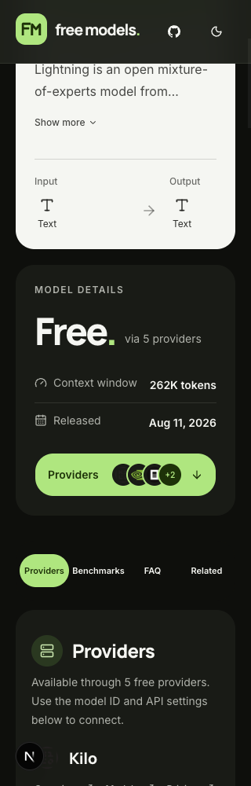

The compact free-allowance card's corner arrow was removed in the previous continuation; the card remains clickable.

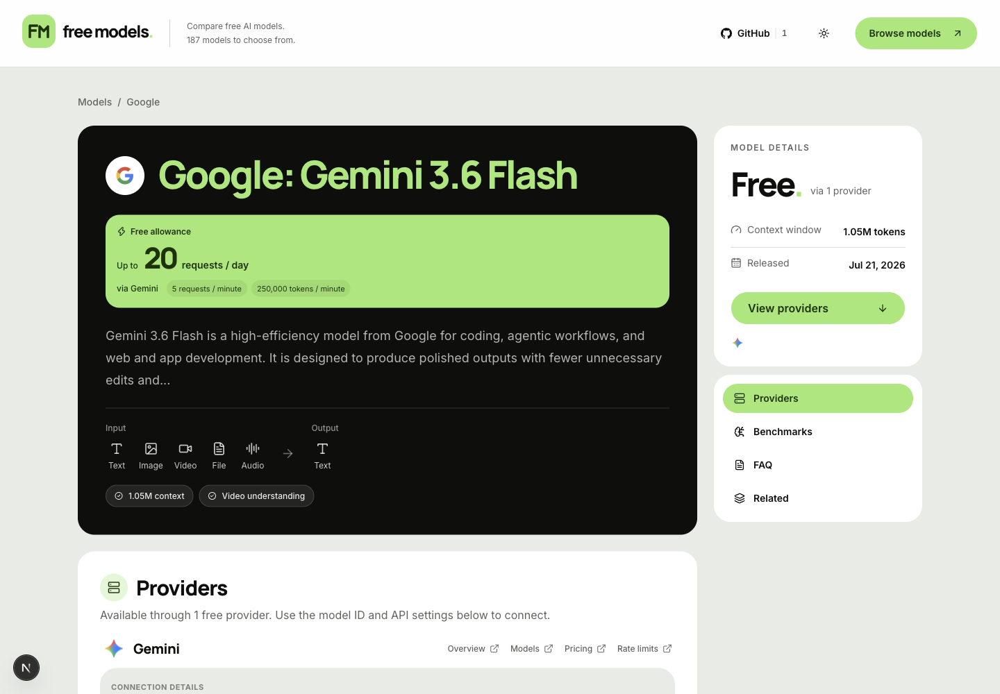

### Model detail page

The app is a statically generated Next.js site in `apps/web`. The dev server is running at `http://localhost:3000`.

The current model detail page has:

- A contrasting model hero card with lime model name and provider logo.
- A floating desktop sidebar containing model details and section navigation.
- A free-usage summary sourced from provider limits instead of showing the model ID.
- Input → Output modality flow with icons in the hero card.
- Data-backed standout feature chips such as benchmark rank, large context, and video understanding.
- Provider connection cards, rate limits, FAQ, and related models.
- Benchmark source tabs for Artificial Analysis and Design Arena.
- Recharts distributions with hover details, a desktop radar chart, mobile category bars, and an Elo/win-rate switch.
- A compact logo/title row and a lime free-allowance card with an emphasized quota and secondary limit chips.

The current model catalogue layout has not been changed as part of the detail-page work.

## Latest reference images

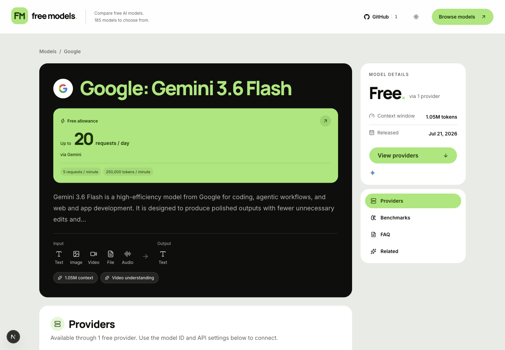

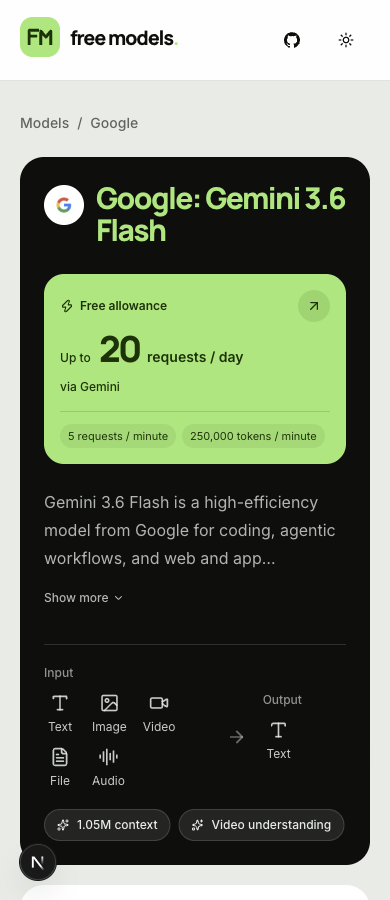

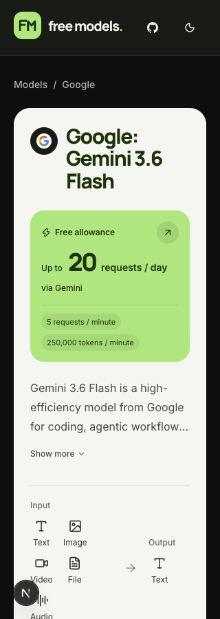

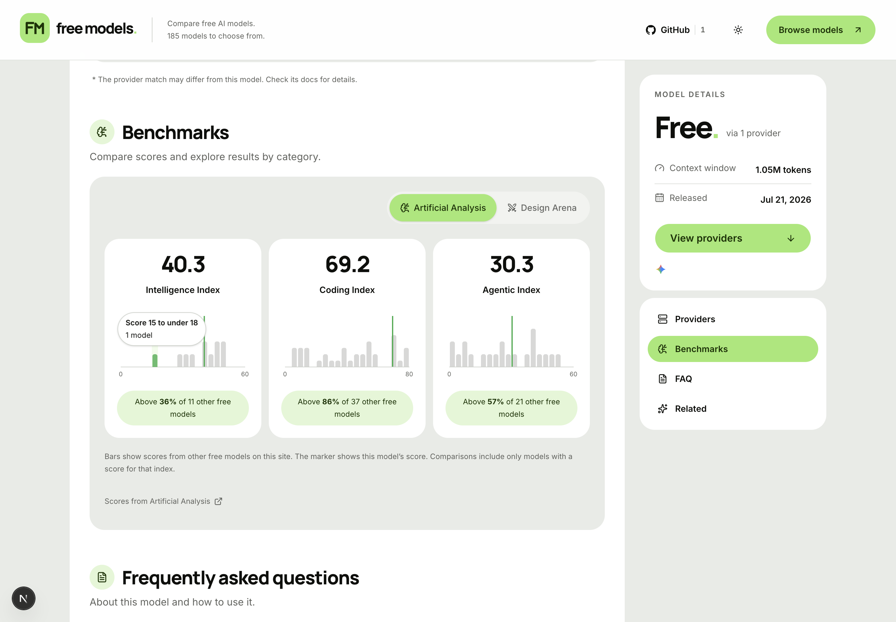

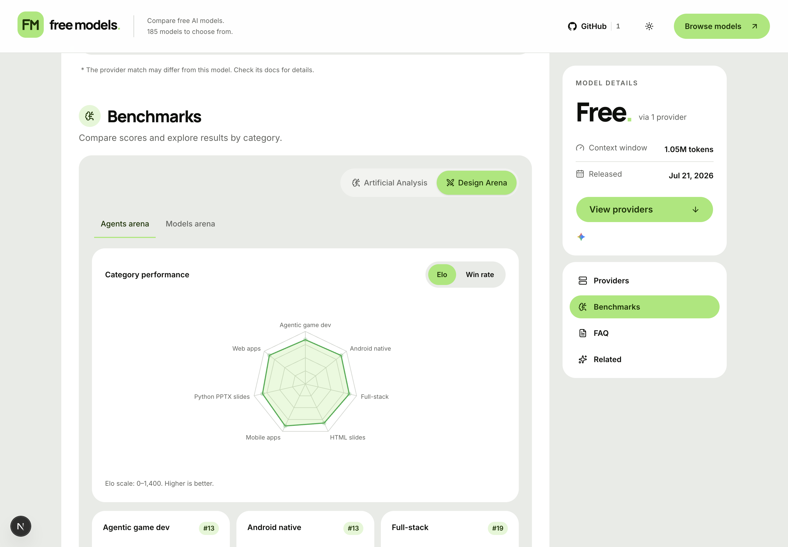

## Original feedback and completed work

### 1. Logo-to-title spacing — complete

The avatar now sits beside the title at all widths. Both scale down on mobile, and the title can wrap without separating from the logo. The screenshot below records the original issue.

Relevant file: [`model-overview.tsx`](apps/web/src/components/model-overview.tsx)

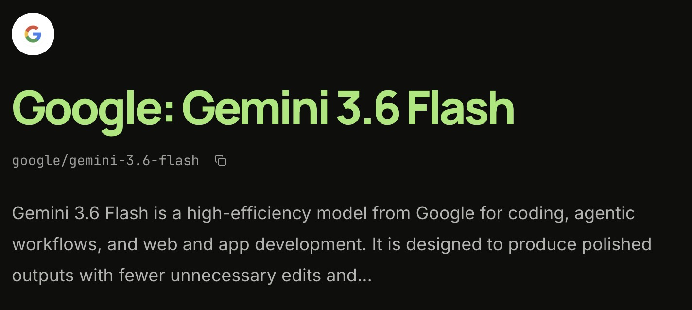

### 2. Free-limit summary — complete

The original block read as three plain text lines:

> Up to 20 requests / day free
>
> via Gemini
>
> Also applies: 5 requests / minute · 250,000 tokens / minute

It is now a compact lime allowance card with a large quota, provider name, and secondary cap chips. The whole card links to that provider’s connection details; the corner arrow was removed at the user’s request. The existing selection logic and qualifier text are preserved. Missing limits still show a link to check providers.

Relevant files: [`model-overview.tsx`](apps/web/src/components/model-overview.tsx), [`model-free-limit.ts`](apps/web/src/lib/model-free-limit.ts)

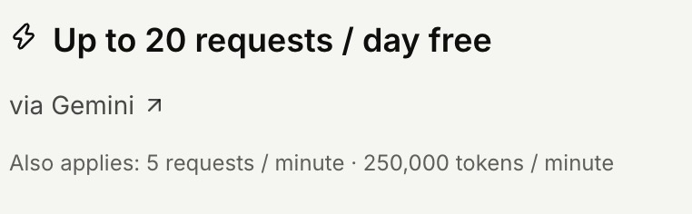

### 3. Chart-library migration — complete

Recharts 3.10.1 is installed in the web workspace and recorded in the Bun lockfile. The handwritten chart geometry has been removed.

Current chart code:

- [`model-arena-chart.tsx`](apps/web/src/components/model-arena-chart.tsx) uses a responsive radar for three or more categories on desktop and horizontal Recharts bars on mobile or for fewer categories. All scored categories are included.
- [`model-benchmarks.tsx`](apps/web/src/components/model-benchmarks.tsx) uses numeric-axis distribution bars, an exact-score reference line, and tooltips with score ranges and peer counts.

The charts support keyboard navigation through Recharts’ accessibility layer. Animations are disabled to avoid chart motion and make metric changes immediate. Existing score cards remain available as readable values. OpenRouter test scores and tournament counts have not been fabricated.

Useful references:

- [Recharts RadarChart API](https://recharts.github.io/en-US/api/RadarChart/)
- [Recharts ResponsiveContainer API](https://recharts.github.io/api/ResponsiveContainer/)
- [Recharts Tooltip API](https://recharts.github.io/en-US/api/Tooltip/)

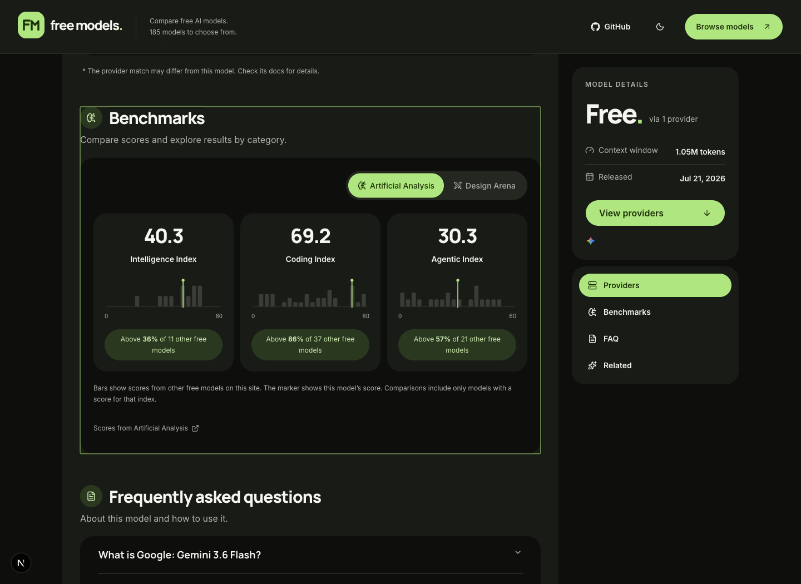

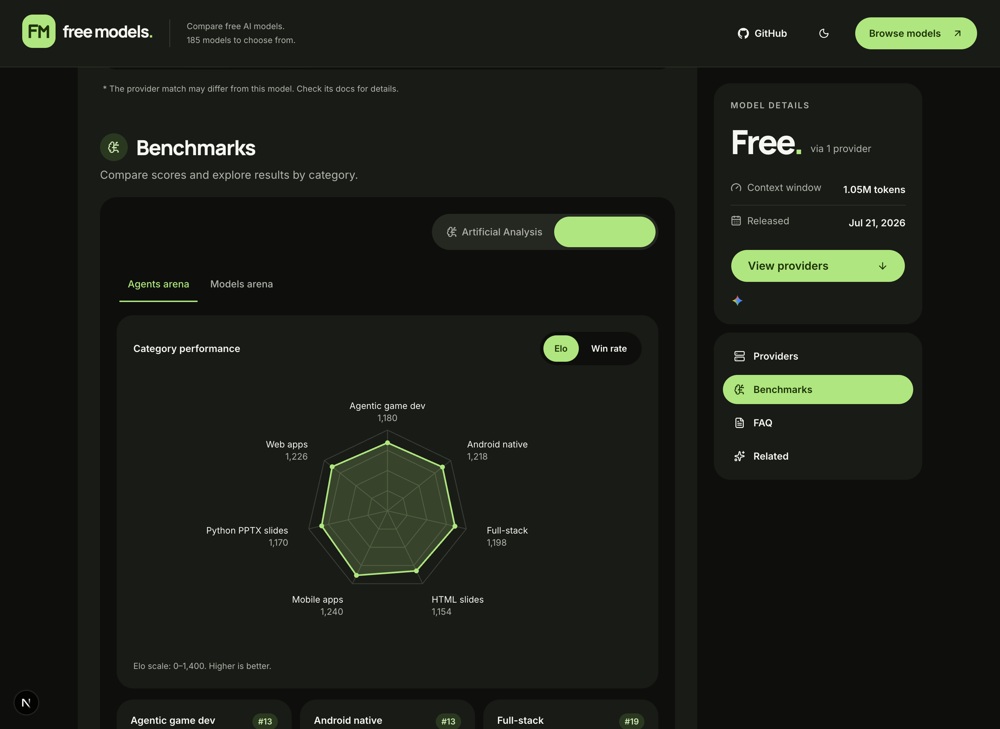

### 4. Keep benchmark data within the static data contract

The web app is intentionally SSG. `apps/web/AGENTS.md` says to use the supplied `free-models.json` data and not add upstream metadata fetching. The available benchmark fields are:

- Artificial Analysis: intelligence, coding, and agentic indexes.
- Design Arena: arena, category, Elo, rank, and win rate.

The comparison histograms currently compare against models in the static model list. If more detailed Artificial Analysis categories are needed later, add them to the generated static data pipeline first rather than fetching OpenRouter at page render time.

## Design references

The OpenRouter page that inspired the benchmark layout uses two source tabs, three large score cards, comparison distributions, and a Design Arena category view. These screenshots are references only; the site must use its own static data and visual language.

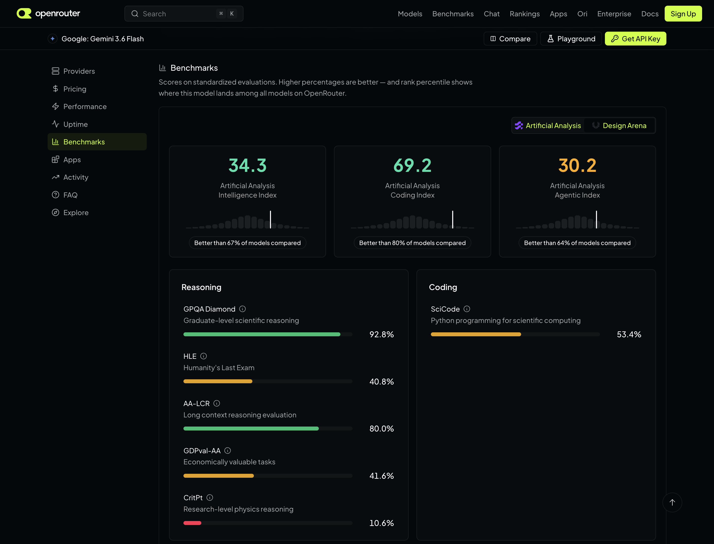

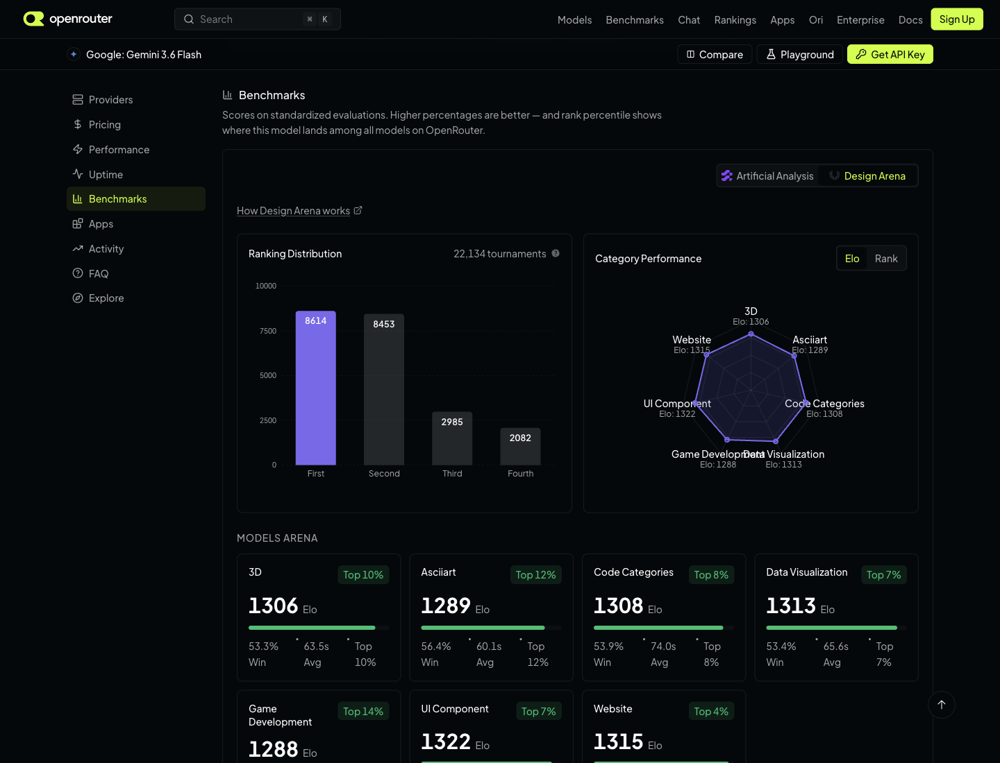

The earlier generic capability pills were intentionally removed from the hero. They did not distinguish one model from another. Standout features should remain data-backed.

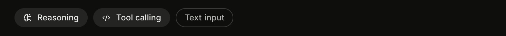

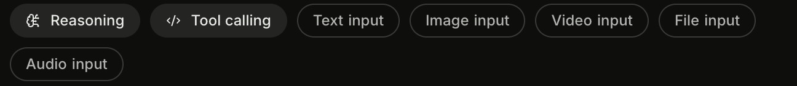

## Important files

| File | Responsibility |
| --- | --- |
| [`model-overview.tsx`](apps/web/src/components/model-overview.tsx) | Hero card, free-limit summary, model details card |
| [`model-modalities.tsx`](apps/web/src/components/model-modalities.tsx) | Input → Output modality display |
| [`model-free-limit.ts`](apps/web/src/lib/model-free-limit.ts) | Selects the best usable free limit and preserves secondary caps |
| [`model-highlights.ts`](apps/web/src/lib/model-highlights.ts) | Selects standout benchmark/capability highlights |
| [`model-benchmarks.tsx`](apps/web/src/components/model-benchmarks.tsx) | Benchmark tabs, score cards, Arena cards |
| [`model-arena-chart.tsx`](apps/web/src/components/model-arena-chart.tsx) | Responsive Recharts radar/bars and metric switch |
| [`model-benchmarks.ts`](apps/web/src/lib/model-benchmarks.ts) | Builds static peer distributions for index scores |
| [`model-detail.tsx`](apps/web/src/components/model-detail.tsx) | Page layout, providers, benchmarks, FAQ, related models |
| [`model-detail-navigation.tsx`](apps/web/src/components/model-detail-navigation.tsx) | Floating desktop section navigation and mobile section nav |
| [`model-data.ts`](apps/web/src/lib/model-data.ts) | Static model loading and normalization |
| [`DESIGN.md`](DESIGN.md) | Color, type, spacing, card, and interaction direction |

## Remaining considerations

- Await user feedback on the updated visual treatment; no implementation item from this handoff remains open.
- Detailed benchmark categories beyond the supplied data still require a separate static data pipeline change.
- Preserve the model list layout and the floating detail sidebar in future iterations.

## Last known validation

Latest orbit continuation: targeted Biome checks, TypeScript, and the 190-page static build pass. Browser checks cover 320px, 768px, and 1440px without horizontal overflow. All six glyphs have internal CSS animations. Reduced motion disables both orbit and glyph animations; focus pauses motion and logo swapping. No motion button or task labels remain. Every orbit icon has zero border and no shadow. Animated task glyphs have rounded theme backgrounds; publisher/provider logos have transparent backgrounds. The CTA links to the model list.

Earlier detail-page validation:

- `bun run --filter web typecheck` passed.
- Targeted Biome checks passed for all five changed source/package files.
- `bun run --filter web build` passed: all 190 pages generated statically.
- Browser checks covered 1440px and 1280px desktop, 390px and 320px mobile, and both themes. No horizontal page overflow was observed.
- Verified distribution and radar tooltips, the Elo/win-rate switch, and mobile bar rendering.
- Verified the longest current model title and a model with no benchmark/modality data. A server-render smoke check covered missing limits, modalities, and highlights.
